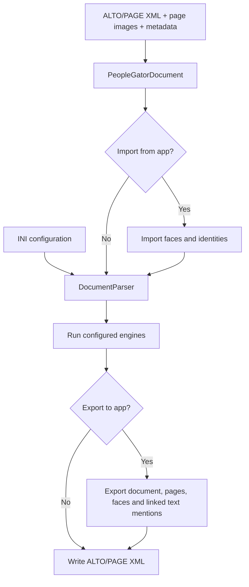
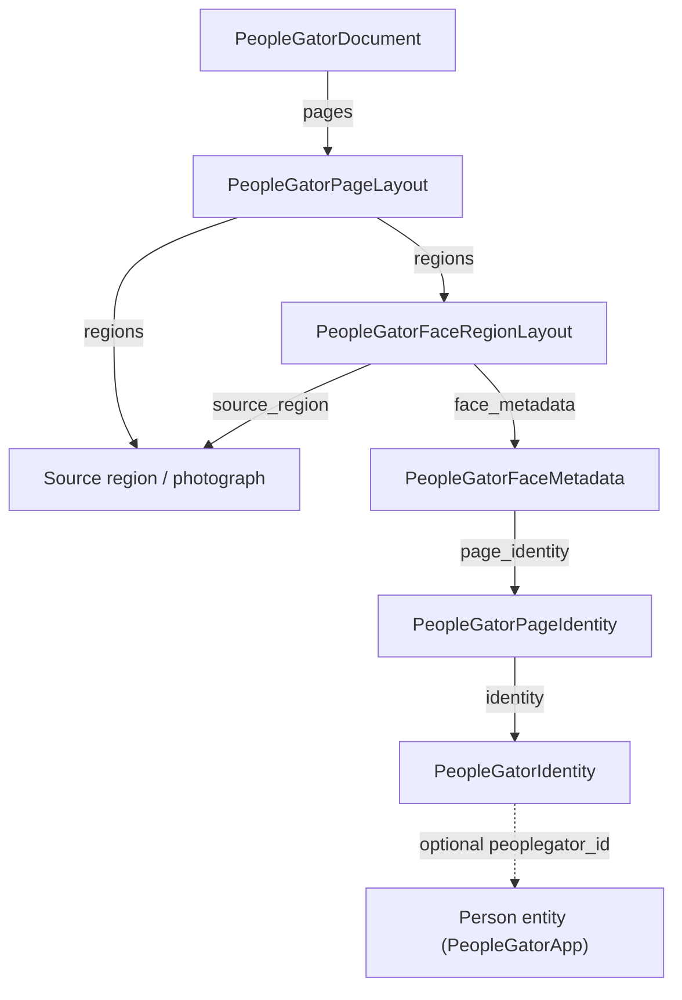

# Architecture

PeopleGator processes digitized pages to detect faces, associate them with person identities, and export enriched document annotations. Planned development work is tracked in [TODO.md](TODO.md).

## Processing API

The processing API uses [DocAPI](https://github.com/DCGM/DocAPI). The client submits page images, ALTO/PAGE XML, and optional document metadata. A worker polls for jobs, obtains the inputs and processing configuration, runs PeopleGator, and returns the resulting files through the API.


The entry points are `processing_api/client.py`, `processing_api/api.py`, and `processing_api/worker.py`.

## Database API

The database API is implemented in [PeopleGatorApp](https://github.com/DCGM/PeopleGatorApp). PeopleGator communicates with it over HTTP through `DatabaseApiService` in `people_gator/core/db.py`.

| Operation | Purpose |
| --- | --- |
| Import | Load previously stored face occurrences and assigned identities before processing. |
| Search and match | Find person entities using names proposed by the processing engines. |
| Export | Create document, page, face and linked text-mention records and upload page images and layout data. |

The `[DB_API]` configuration defines the connection. The CLI switches `--import-from-app` and `--export-to-app` enable the corresponding stages. See [Database API](PROCESSING.md#database-api) for the connection settings.

## Processing architecture

The local script loads the INI configuration and constructs a `PeopleGatorDocument` from page images, source ALTO/PAGE XML, and optional JSON metadata. `DocumentParser` creates and runs the configured engines in INI section order.

When `[PARSE_FOLDER] PROCESSING_CHECKPOINTS` or `--processing-checkpoints` names
a directory, the parser saves the returned document and the next engine index after each
successful engine. `--resume-from-checkpoint` loads a trusted Pickle/JSON pair,
skips initial XML loading and app import, and runs the remaining engines using
the current configuration. See [Processing checkpoints and recovery](CHECKPOINTS.md).



The available engines perform text entity detection and clustering, face detection, LLM-assisted naming, and entity matching. See [Processing](PROCESSING.md).

### Processing implementation principles

The intended direction of processing responsibilities is:

```text
DocumentParser
    -> configured document-processing engines
        -> existing document/page/mention/cluster/identity models
        -> small shared utilities and existing service infrastructure
```

The parser orchestrates import, ordered engine execution, checkpoint boundaries
and export. Each engine receives the existing document, performs its own
processing and returns the document for the next stage. Engine-specific decisions,
evidence selection and final prompt construction belong to that engine's module;
shared LLM infrastructure handles common template, request and response
operations, not specialized processing decisions.

Use existing domain models for genuine data access, manipulation and common
record serialization, and small stateless functions for reusable operations.
Engines should not depend on another engine's internal processing or prompt
construction. Avoid intermediary processing layers that only relocate complexity.

The independent `people_gator/text/` package owns reusable OCR chunking, source
mappings and normalization. Its chunker supplies source-mapped OCR chunks to the
text detection engine; it is not a document-processing engine. See
[chunker inputs, outputs and configuration](PROCESSING.md#reusable-text-chunking)
and [implementation rules](../AGENTS.md#implementation-style-and-scope).

## Data model

The main in-memory objects and their relationships are:



| Object | Important fields |
| --- | --- |
| Document | `id`, `name`, `library`, page layouts, text-entity clusters |
| Page layout | Page ID, image size, regions, text-entity mentions |
| Face region | Polygon, confidence, source-region reference |
| Face metadata | Five landmarks, MODS/tag identifiers, provenance, page identity |
| Person identity | Proposed name, optional app entity ID, other identifiers |

The broader system design also includes occurrences of person names in OCR text. `PeopleGatorTextEntityMention` and `PeopleGatorTextEntityCluster` represent related information in the current document model.


## Repository responsibilities

| Component | Responsibility |
| --- | --- |
| `people_gator/core/document_parser.py` | Configured engine orchestration and application import/export. |
| `people_gator/core/layout.py` | Page/document objects, face-region metadata, ALTO/PAGE I/O and rendering. |
| `people_gator/core/checkpoints.py`, `checkpoint_inspection.py` | Native Pickle/JSON save and resume, and selected read-only JSON diagnostics. |
| `people_gator/engines/base.py` | Common processing-engine interfaces. |
| `people_gator/text/` | Reusable OCR chunking, canonical page mappings, offset-preserving normalization and text validation; independent of processing engines. |
| `people_gator/engines/face_detection.py` | YOLO detection in selected image regions; boxes and five landmarks. |
| `people_gator/engines/face_assignment.py` | LLM-supported single/batch naming using images, captions and OCR text. |
| `people_gator/engines/entity_matching.py` | Candidate-entity lookup, LLM disambiguation and creation through the app API. |
| `people_gator/engines/llm.py` | Shared required-prompt validation, template/data key diagnostics, prompt assembly and structured LLM responses. |
| `people_gator/core/db.py`, `connector.py` | Authenticated client for documents, pages, faces and person records. |
| `user_scripts/parse_folder.py` | Local processing entry point. |
| `processing_api/api.py`, `client.py`, `worker.py` | Processing job API, CLI client and worker based on DocAPI. |

## Related software and services

- [pero-ocr](https://github.com/DCGM/pero-ocr) supplies OCR layout primitives, regions and ALTO utilities.
- [AnnoPage](https://github.com/LIBCAS/AnnoPage) supplies page/layout and non-textual-region metadata, including contextual information such as captions.
- [DocAPI](https://github.com/DCGM/DocAPI) supplies job creation, upload/download, server administration, and worker/client wrappers.
- [PeopleGatorApp](https://github.com/DCGM/PeopleGatorApp) provides the person/face database API and the interface for reviewing and correcting assigned identities.
- The configured YOLO and LLM engines supply detection and contextual identification.

The pipeline links source-mapped text mentions and document-level clusters with faces and person identities. Engine ordering, candidate selection, prompt inputs, validation and standalone detection are described in [Processing](PROCESSING.md); ALTO/PAGE, in-memory and app persistence boundaries are described in [Output formats](OUTPUT_FORMATS.md). Optional [checkpoints](CHECKPOINTS.md) preserve post-engine document state. Text-mention XML import/serialization and cluster persistence remain planned work.
