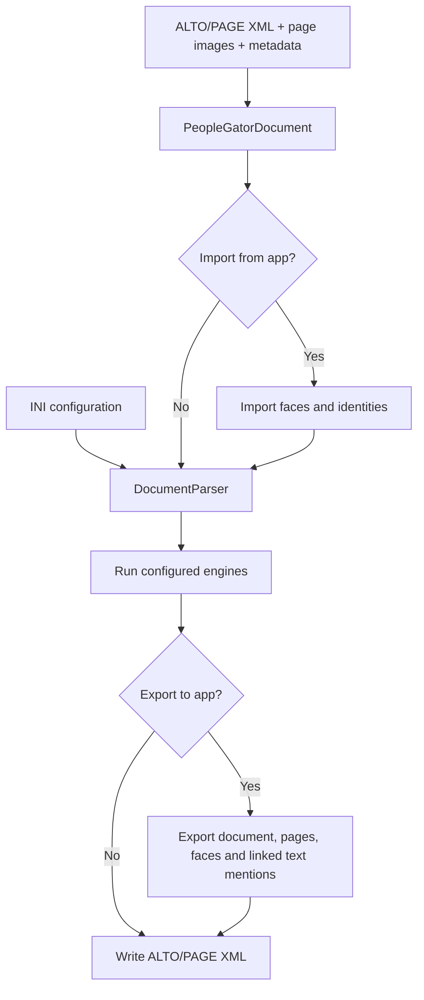
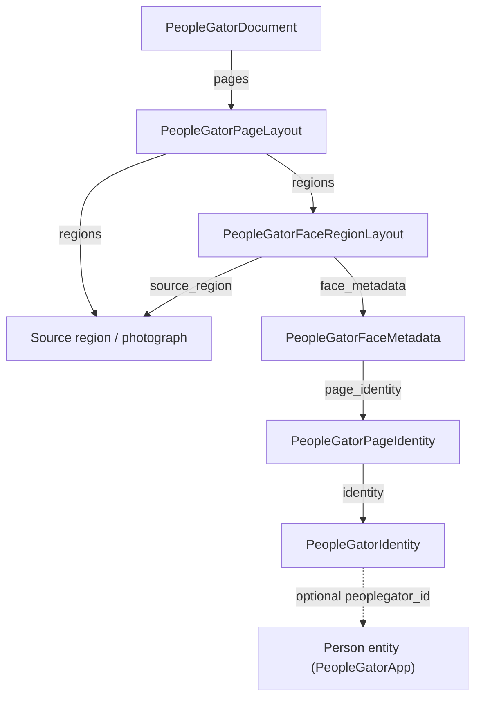

# Architecture

PeopleGator processes digitized pages to detect faces, associate them with person identities, and export enriched document annotations. Planned development work is tracked in [TODO.md](TODO.md).

## Processing API

The processing API uses [DocAPI](https://github.com/DCGM/DocAPI). The client submits page images, ALTO/PAGE XML, and optional document metadata. A worker polls for jobs, obtains the inputs and processing configuration, runs PeopleGator, and returns the resulting files through the API.

The entry points are `processing_api/client.py`, `processing_api/api.py`, and `processing_api/worker.py`.

## Database API

The database API is implemented in [PeopleGatorApp](https://github.com/DCGM/PeopleGatorApp). PeopleGator communicates with it over HTTP through `DatabaseApiService` in `people_gator/core/db.py`.

| Operation | Purpose |
| --- | --- |
| Import | Load previously stored face occurrences and assigned identities before processing. |
| Search and match | Find person entities using names proposed by the processing engines. |
| Export | Create document, page, face and linked text-mention records and upload page images and layout data. |

The `[DB_API]` configuration defines the connection. The CLI switches `--import-from-app` and `--export-to-app` enable the corresponding stages. See [Database API](PROCESSING.md#database-api) for the connection settings.

## Processing architecture

The local script loads the INI configuration and constructs a `PeopleGatorDocument` from page images, source ALTO/PAGE XML, and optional JSON metadata. `DocumentParser` creates and runs the configured engines in INI section order.

When `[PARSE_FOLDER] PROCESSING_CHECKPOINTS` or `--processing-checkpoints` names
a directory, the parser publishes JSON metadata and a complete Pickle document after each
successful engine. `--resume-from-checkpoint` restores its full inherited
document graph and resumes the unfinished engine prefix without loading original
XML or importing app annotations again. Configuration/resource/input fingerprints
and the durable run ledger are checked before execution; app writes and final
exports are fenced independently. See [the contract and inherited-model audit](CHECKPOINTS.md).

The available engines perform text entity detection and clustering, face detection, LLM-assisted naming, and entity matching. See [Processing](PROCESSING.md).

## Data model

The main in-memory objects and their relationships are:

| Object | Important fields |
| --- | --- |
| Document | `id`, `name`, `library`, page layouts, text-entity clusters |
| Page layout | Page ID, image size, regions, text-entity mentions |
| Face region | Polygon, confidence, source-region reference |
| Face metadata | Five landmarks, MODS/tag identifiers, provenance, page identity |
| Person identity | Proposed name, optional app entity ID, other identifiers |

The broader system design also includes occurrences of person names in OCR text. `PeopleGatorTextEntityMention` and `PeopleGatorTextEntityCluster` represent related information in the current document model.

## Repository responsibilities

| Component | Responsibility |
| --- | --- |
| `people_gator/core/document_parser.py` | Configured engine orchestration and application import/export. |
| `people_gator/core/layout.py` | Page/document objects, face-region metadata, ALTO/PAGE I/O and rendering. |
| `people_gator/core/checkpoints.py`, `checkpoint_document.py`, `checkpoint_inspection.py` | Hybrid checkpoint publication, trusted Pickle recovery, selected read-only JSON diagnostics, compatibility/integrity checks and durable app replay guards. |
| `people_gator/engines/base.py` | Common processing-engine interfaces. |
| `people_gator/text/` | Reusable text chunker, factory and exact OCR source mappings; consumed internally by text detectors. |
| `people_gator/engines/face_detection.py` | YOLO detection in selected image regions; boxes and five landmarks. |
| `people_gator/engines/face_assignment.py` | LLM-supported single/batch naming using images, captions and OCR text. |
| `people_gator/engines/entity_matching.py` | Candidate-entity lookup, LLM disambiguation and creation through the app API. |
| `people_gator/engines/llm.py` | Shared required-prompt validation, template/data key diagnostics, prompt assembly and structured LLM responses. |
| `people_gator/core/db.py`, `connector.py` | Authenticated client for documents, pages, faces and person records. |
| `user_scripts/parse_folder.py` | Local processing entry point. |
| `processing_api/api.py`, `client.py`, `worker.py` | Processing job API, CLI client and worker based on DocAPI. |

The public `people_gator.text` imports expose `TextChunker`,
`LineAwareTextChunker`, `text_chunker_factory`, `TextChunkCollection`, `TextChunk`,
`ChunkMapping`, `SourceLine`, and `SourceSpan`. This component reads a
`PeopleGatorDocument` and returns an immutable chunk collection without changing
the document. It uses only standard-library runtime imports. It is not registered
as a `DocumentProcessingEngine`. The text detection engine owns its lifecycle and
extracts `CHUNKING_*` settings from its own `[ENGINE_*]` section, stripping the
prefix before calling the factory with `METHOD`, `MAX_CHARS`, and
`OVERLAP_CHARS`. There is no global or nested chunking section and no change to
`DocumentParser` engine loading. Text detection,
mention construction and overlap de-duplication are owned by the detector;
document clustering is described below; shared app linking follows through `ENTITY_MATCHING`.
See [text chunking](PROCESSING.md#reusable-text-chunking) for the public contract.

## Related software and services

- [pero-ocr](https://github.com/DCGM/pero-ocr) supplies OCR layout primitives, regions and ALTO utilities.
- [AnnoPage](https://github.com/LIBCAS/AnnoPage) supplies page/layout and non-textual-region metadata, including contextual information such as captions.
- [DocAPI](https://github.com/DCGM/DocAPI) supplies job creation, upload/download, server administration, and worker/client wrappers.
- [PeopleGatorApp](https://github.com/DCGM/PeopleGatorApp) provides the person/face database API and the interface for reviewing and correcting assigned identities.
- The configured YOLO and LLM engines supply detection and contextual identification.

The broader data model includes **Entity** (a person), **Face** (a detected face occurrence), **Source** (document/page reference), and source-mapped person mentions in page text; independent document clustering operates before app linking. An occurrence is linked to source material and may refer to an entity. The [Processing](PROCESSING.md) guide describes the matching stages.

`people_gator/engines/text_entity_detection.py` registers `TEXT_ENTITY_DETECTION`
through the existing factory. It composes the independent chunker and shared
`LLMBasedEngine`/`LLMPrompter` with nested Pydantic response models and externally
configured prompt templates, stages source-mapped mentions, then updates page
`text_entities` atomically. Optional identity and multiline `SourceSpan` tuples
extend the existing mention model; canonical names/descriptions are detection
metadata, not app identities. Document clustering is a separate engine; face
cooperation and persistence remain separate #33 tasks. See [the detector contract](PROCESSING.md#text-entity-detection-text_entity_detection).

`user_scripts/detect_text_entities.py` is a standalone diagnostic path: validate
an ALTO/PAGE directory, load it through `PeopleGatorDocument`, select exactly one
text detector through the ordinary engine factory, then print per-page summaries or write
an atomic JSON snapshot grouped by source page (including empty pages),
with mentions and their OCR provenance. It does not
construct `DocumentParser` or execute other configured engines/app services. The
module CLI uses processing extras and introduces no package dependency changes.

`people_gator/engines/text_entity_clustering.py` registers
`TEXT_ENTITY_CLUSTERING` after detection in configured INI order. It adapts
weighted canonical/alias fuzzy components and shared LLM disambiguation to
request-local, one-mention records, preserving direct member references. Strict
Pydantic partitions and staged commit retain every occurrence, while existing
clusters and page identities are protected. Unlinked clusters use `identity=None`,
consolidated `name`/`description` and optional `short_description`. This stage
requires neither image loading nor app access and adds no XML persistence. See
[the clustering contract](PROCESSING.md#document-text-entity-clustering-text_entity_clustering).

Both face-assignment engines now use `engines/face_entity_context.py` to read
original document mentions and membership-linked provisional clusters. The shared
selector prepares caption-only evidence or distinct surrounding/page/off-page
fallback collections per source image; no text model, parallel entity store,
app identity or extra request is introduced. `process_document` passes the
original document into page request preparation in every execution mode. See
[face prompt data and migration](PROCESSING.md#text-evidence-in-face-assignment).

`ENTITY_MATCHING` resolves original document text clusters and named faces using
shared `PeopleGatorIdentity` references or unique source-mapped caption evidence.
It supplies names, aliases, descriptions and source context to the LLM for
semantic select/create/unresolved decisions. The engine validates only response
structure and candidate references; it does not compare description contents or
quoted fragments. Equivalent duplicate app records may be selected; app record
merging/cleanup stays with human/application workflows. Successful IDs propagate
without rebuilding clusters or replacing protected links/local identity metadata. The existing factory,
shared `[DB_API]` client and external prompt conventions remain in use. Creation
receipts on the document protect same-document retries after uncertain writes;
optional [processing checkpoints](CHECKPOINTS.md) persist complete receipts and
durably fence stage/export replay. There is no server idempotency guarantee. See
[linking rules](PROCESSING.md#document-wide-entity-linking-entity_matching).
The optional DB-based assignment of unnamed faces (step 5) remains deferred;
text XML serialization, import, cluster persistence and complete round-trip remain
step 7 of #33. Normal app export now sends each linked page text occurrence via
the existing `export_document()` and shared connector, preserving all in-memory
OCR provenance. See [export fields and rerun limits](OUTPUT_FORMATS.md#peoplegatorapp-text-mention-export).
