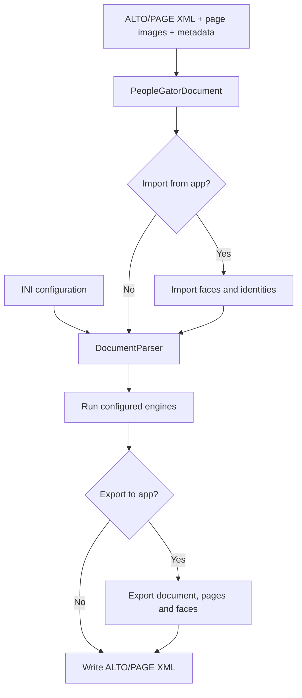
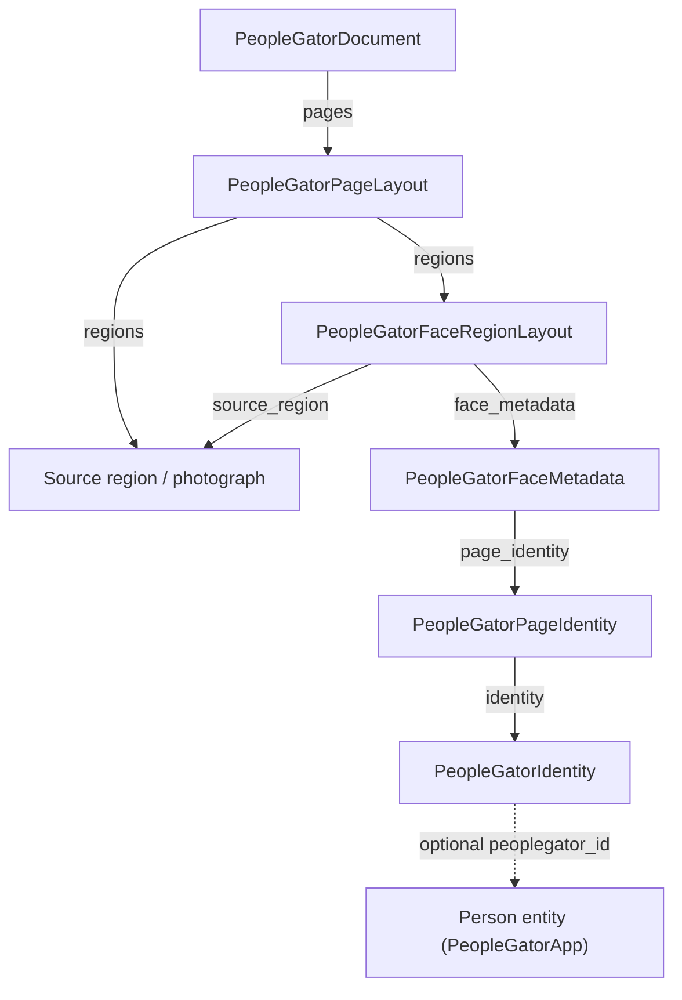

# Architecture

PeopleGator processes digitized pages to detect faces, associate them with person identities, and export enriched document annotations. Planned development work is tracked in [TODO.md](TODO.md).

## Processing API

The processing API uses [DocAPI](https://github.com/DCGM/DocAPI). The client submits page images, ALTO/PAGE XML, and optional document metadata. A worker polls for jobs, obtains the inputs and processing configuration, runs PeopleGator, and returns the resulting files through the API.

The entry points are `processing_api/client.py`, `processing_api/api.py`, and `processing_api/worker.py`.

## Database API

The database API is implemented in [PeopleGatorApp](https://github.com/DCGM/PeopleGatorApp). PeopleGator communicates with it over HTTP through `DatabaseApiService` in `people_gator/core/db.py`.

| Operation | Purpose |
| --- | --- |
| Import | Load previously stored face occurrences and assigned identities before processing. |
| Search and match | Find person entities using names proposed by the processing engines. |
| Export | Create document, page, and face records and upload page images and layout data. |

The `[DB_API]` configuration defines the connection. The CLI switches `--import-from-app` and `--export-to-app` enable the corresponding stages. See [Database API](PROCESSING.md#database-api) for the connection settings.

## Processing architecture

The local script loads the INI configuration and constructs a `PeopleGatorDocument` from page images, source ALTO/PAGE XML, and optional JSON metadata. `DocumentParser` creates and runs the configured engines in INI section order.

The available engines perform face detection, LLM-assisted naming, and entity matching. See [Processing](PROCESSING.md).

## Data model

The main in-memory objects and their relationships are:

| Object | Important fields |
| --- | --- |
| Document | `id`, `name`, `library`, page layouts, text-entity clusters |
| Page layout | Page ID, image size, regions, text-entity mentions |
| Face region | Polygon, confidence, source-region reference |
| Face metadata | Five landmarks, MODS/tag identifiers, provenance, page identity |
| Person identity | Proposed name, optional app entity ID, other identifiers |

The broader system design also includes occurrences of person names in OCR text. `PeopleGatorTextEntityMention` and `PeopleGatorTextEntityCluster` represent related information in the current document model.

## Repository responsibilities

| Component | Responsibility |
| --- | --- |
| `people_gator/core/document_parser.py` | Configured engine orchestration and application import/export. |
| `people_gator/core/layout.py` | Page/document objects, face-region metadata, ALTO/PAGE I/O and rendering. |
| `people_gator/engines/base.py` | Common processing-engine interfaces. |
| `people_gator/engines/face_detection.py` | YOLO detection in selected image regions; boxes and five landmarks. |
| `people_gator/engines/face_assignment.py` | LLM-supported single/batch naming using images, captions and OCR text. |
| `people_gator/engines/entity_matching.py` | Candidate-entity lookup, LLM disambiguation and creation through the app API. |
| `people_gator/engines/llm.py` | Prompt assembly and structured responses from a configured LLM service. |
| `people_gator/core/db.py`, `connector.py` | Authenticated client for documents, pages, faces and person records. |
| `user_scripts/parse_folder.py` | Local processing entry point. |
| `processing_api/api.py`, `client.py`, `worker.py` | Processing job API, CLI client and worker based on DocAPI. |

## Related software and services

- [pero-ocr](https://github.com/DCGM/pero-ocr) supplies OCR layout primitives, regions and ALTO utilities.
- [AnnoPage](https://github.com/LIBCAS/AnnoPage) supplies page/layout and non-textual-region metadata, including contextual information such as captions.
- [DocAPI](https://github.com/DCGM/DocAPI) supplies job creation, upload/download, server administration, and worker/client wrappers.
- [PeopleGatorApp](https://github.com/DCGM/PeopleGatorApp) provides the person/face database API and the interface for reviewing and correcting assigned identities.
- The configured YOLO and LLM engines supply detection and contextual identification.

The broader data model includes **Entity** (a person), **Face** (a detected face occurrence), **Source** (document/page reference), and planned person mentions in text at page/document level. An occurrence is linked to source material and may refer to an entity. The [Processing](PROCESSING.md) guide describes the matching stages.
